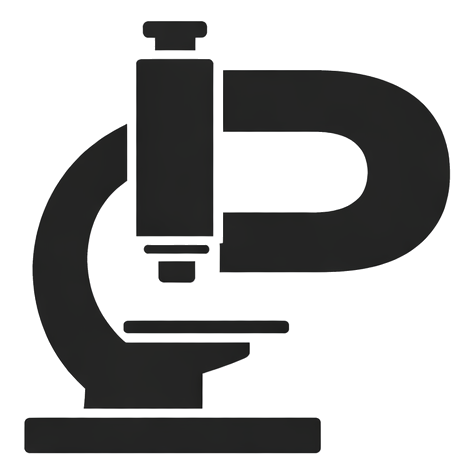
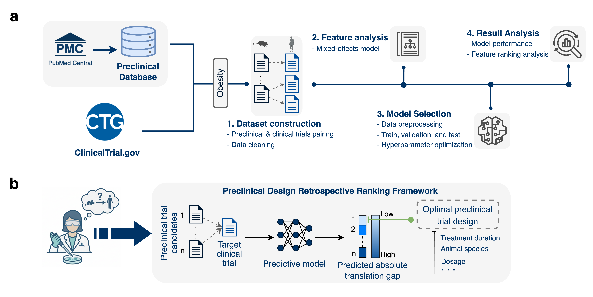

# Animal-to-human (A2H) Translation (Preclinical Database and Obesity case study)

Please check out our PCDB website: https://www.preclinicaldata.org</img>

The preclinical database (PCDB) is an open-source database derived from the biomedical literature database, PubMed Central (PMC), and linked diseases, drug compounds, and animal species entities to public databases. Large language models were applied to filter publications searched through PMC via query templates with MeSH disease concepts and extracted entity mentions in the publications. All entites were linked and standardized to the public database based on their ontology structure to ensure proper semantic categories (e.g., disease entities are under MeSH Diseases category). As a case study, we connected preclinical evidence for Obesity drug development to corresponding clinical studies and identified key factors for lowering translation gaps. We also provided a preclinical trial design recommendation system for obesity drugs.

This repository contains code for reproducible PCDB construction, including the entity linking and validation logics, complete analysis code for the A2H Obesity dataset, and a demonstration of the preclinical design recommendation system via retrospective ranking of preclinical trial arms.



## Directories

- [`data/obesity`](./data/obesity) contains the raw data for the obesity case study used in this project.
- [`data/PCDB`](./data/PCDB) contains only instructions for downloading the database due to the large data size.
- [`data/PCDB/upstream_retrieval`](./data/PCDB/upstream_retrieval) contains the frozen inputs of the upstream PCDB pipeline (search queries, retrieved articles, classifier labels and splits).
- [`outputs`](./outputs/) contains the outputs generated by the code.
- [`scripts`](./scripts/) contains the shell scripts used in this project.
- [`src`](./src/) contains the Python source code used in this project.

## Getting Started
The pipeline is routinely exercised on Ubuntu 22.04 with Python 3.11. The steps below assume a Conda-based workflow; feel free to adapt them to your environment management tool of choice.

### Clone the repository
```console
git clone https://github.com/IBPA/A2H_PCDB_Obesity.git
cd A2H_PCDB_Obesity
```

### Create and activate a Conda environment (Install dependencies via Conda)
```console
conda env create -f environment.yml
conda activate A2H_PCDB_obesity
```
You can leave the environment at any point with `conda deactivate`.

## PCDB Construction
### Upstream: literature retrieval, article classification, entity extraction
```console
bash scripts/run_pcdb_upstream.sh retrieval      # PMC search + open-access article selection
bash scripts/run_pcdb_upstream.sh classifier     # fine-tune and evaluate the Llama 3.3 70B classifier
bash scripts/run_pcdb_upstream.sh score_corpus   # score all retrieved articles
bash scripts/run_pcdb_upstream.sh extraction     # extract diseases, drugs and animal models with Mistral Large
```
The frozen search specification (run 14 Nov 2024), article counts at every stage, classifier splits and predictions, and the extraction model and prompts are documented in [`src/PCDB/upstream_retrieval/README.md`](./src/PCDB/upstream_retrieval/README.md). The frozen intermediate files are in [`data/PCDB/upstream_retrieval`](./data/PCDB/upstream_retrieval) and [`outputs/pcdb/upstream_retrieval`](./outputs/pcdb/upstream_retrieval), so the later stages can be checked without re-running the GPU steps.

### Entity linking and database build
```console
sh scripts/create_PCDB.sh
```
Additional data files need to be downloaded first (see data/PCDB/README.md) to run the construction code.

### Experimental relation extraction
```console
bash scripts/run_pcdb_relations.sh prompts       # one prompt per publication from the entity-linking table and PMC full text
bash scripts/run_pcdb_relations.sh serve         # vLLM server, one per GPU
bash scripts/run_pcdb_relations.sh extract       # label every asserted relation (resumable)
bash scripts/run_pcdb_relations.sh release       # pcdb_complete.tsv, pcdb.tsv, publication_extractions.tsv, workbook, statistics
```
PCDB records which entities a publication mentions, not which took part in the same experiment. This stage asks a language model, per publication, which of the asserted disease–drug, disease–animal, drug–animal and disease–drug–animal relations an in vivo experiment in the paper supports. From release v2.0 the result defines the row tables: `pcdb_complete.tsv` holds one row per labelled relation, `pcdb.tsv` one row per experimentally confirmed disease–drug–animal triple, and `publication_extractions.tsv` one row per publication with the extracted names and identifiers. The stage reads the entity-linking output of `scripts/create_PCDB.sh` (`outputs/pcdb/pcdb_complete.tsv`), which is not itself published. The model's verdicts are frozen in `data/PCDB/pcdb_relations/`, fetched by `data/PCDB/download.sh`, so the `release` step reproduces the v2.0 tables without a GPU. The prompt, model, validation and statistics are documented in [`src/PCDB/relations/README.md`](./src/PCDB/relations/README.md).

### Retrospective Trial Ranking
```console
sh scripts/run_ml_retrospective_ranking.sh
```

## Authors
- Kaichi Xie — Graduate Student<sup>1,2,3</sup>
- Riyan Townsley — undergraduate Student<sup>1,3</sup>
- Ilias Tagkopoulos — Principal Investigator<sup>1,2,3</sup>

<sup>1</sup> Department of Computer Science, University of California at Davis
<sup>2</sup> Genome Center, University of California at Davis
<sup>3</sup> USDA/NSF AI Institute for Next Generation Food Systems (AIFS)

## Contact
Questions, bug reports, and collaboration ideas are welcome at Kaichi Xie (`kcxie@ucdavis.edu`) or Prof. Ilias Tagkopoulos (`itagkopoulos@ucdavis.edu`).

## Citation
The accompanying paper is under review at *BioData Mining*. If you use A2H or PCDB in your research, please cite it once published; a formal citation will appear here.

## License
 released under the Apache-2.0 License. See [`LICENSE`](./LICENSE) for the full text and usage terms.


## Funding
This work is supported by the USDA-NIFA AI Institute for Next Generation Food Systems (AIFS), USDA-NIFA award number 2020-67021-32855.
